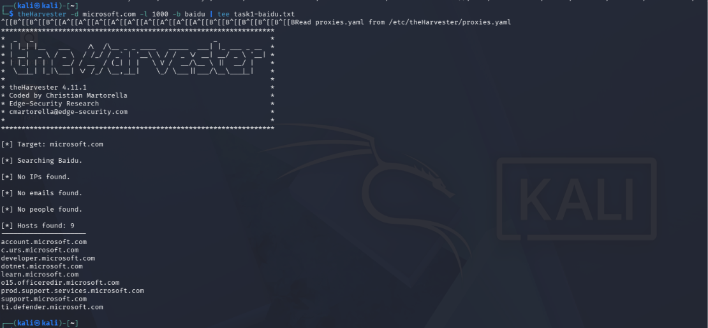
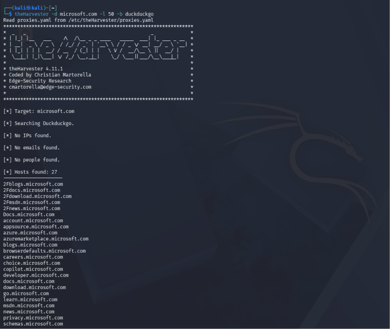
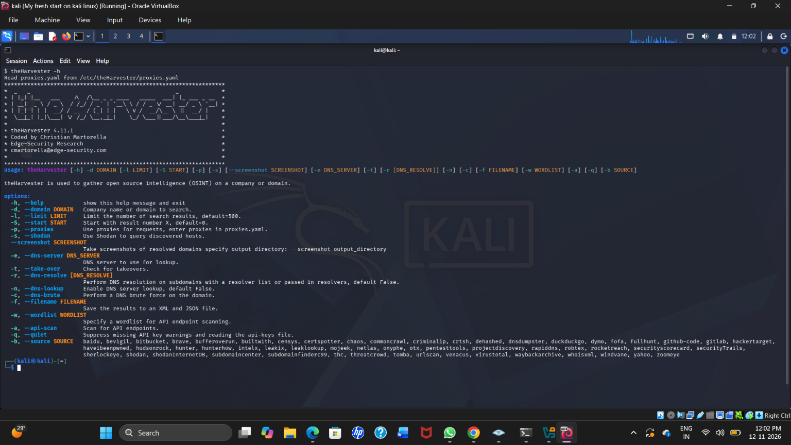

# W2-PM4 – Footprinting & Reconnaissance Using theHarvester


## Project Information

| Details | Information |
|---|---|
| Project | W2-PM4 |
| Organization | NetworkWalks |
| Batch | B084 |
| Author | Shaik Mahboob Mohiuddin |
| Operating System | Kali Linux |
| Tool | theHarvester 4.11.1 |
| Target Domain | microsoft.com |

## 1. Project Overview

This project demonstrates footprinting and reconnaissance using theHarvester in Kali Linux.

The practical work involved gathering publicly available information about a domain using different search sources, identifying hostnames and exporting the results in JSON and XML formats.

## 2. Objectives

- Understand domain footprinting and reconnaissance.
- Perform OSINT using theHarvester.
- Identify publicly available hostnames and subdomains.
- Use different supported data sources.
- Export scan results in JSON and XML formats.

## 3. Tools Used

- Kali Linux
- theHarvester 4.11.1
- Baidu
- DuckDuckGo
- JSON and XML

## 4. Commands Executed

### Task 1 – Baidu

```bash
theHarvester -d microsoft.com -l 1000 -b baidu
```

Initial result: 9 hostnames discovered.

### Task 2 – DuckDuckGo

```bash
theHarvester -d microsoft.com -l 50 -b duckduckgo
```

Result: 27 hostnames discovered.

### Export Commands

```bash
theHarvester -d microsoft.com -l 1000 -b baidu -f task1-baidu

theHarvester -d microsoft.com -l 50 -b duckduckgo -f task2-duckduckgo
```

## 5. Project Results

| Scan | Hostnames |
|---|---:|
| Baidu initial scan | 9 |
| DuckDuckGo scan | 27 |
| Baidu export rerun | 0 |

The Baidu export files reflect the later run, which returned no hostnames.

**Technical note:** The project guide requested the `all` source. The installed version 4.11.1 did not support that source, so DuckDuckGo was used as an alternative.

## 6. Screenshots – Practical Execution

The following screenshots document the practical work.

### Screenshot 1 – theHarvester Help and Version



### Screenshot 2 – Reconnaissance Results



### Screenshot 3 – theHarvester Execution



### Screenshot 4 – Export Verification


## 7. Project Documentation

| Document | Access |
|---|---|
| Kali Linux Commands and Outputs | [View PDF](Kali_Linux_Commands_Outputs.pdf) |
| W2-PM4 Project Report | [View Project Report](W2-PM4_theHarvester_Report.pdf) |

## 8. Scan Output Files

The exported results are available in the `Output/` directory:

- `task1-baidu.json`
- `task1-baidu.xml`
- `task2-duckduckgo.json`
- `task2-duckduckgo.xml`

## 9. Learning Outcomes

- Practical experience with theHarvester.
- Understanding OSINT reconnaissance.
- Working with different search sources.
- Identifying publicly available hostnames.
- Exporting and reviewing JSON and XML files.
- Understanding tool compatibility and limitations.

## 10. Disclaimer

This project was performed for educational and cybersecurity training purposes. The exercise focused on publicly available information and domain reconnaissance.

---

**Completed as part of NetworkWalks – Week 2 Project Module 4.**
